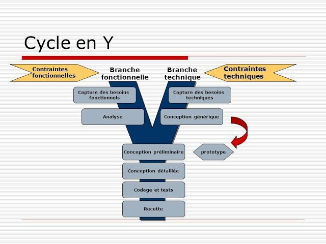
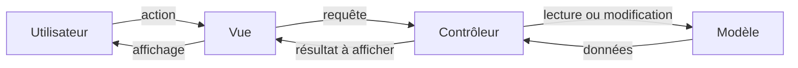
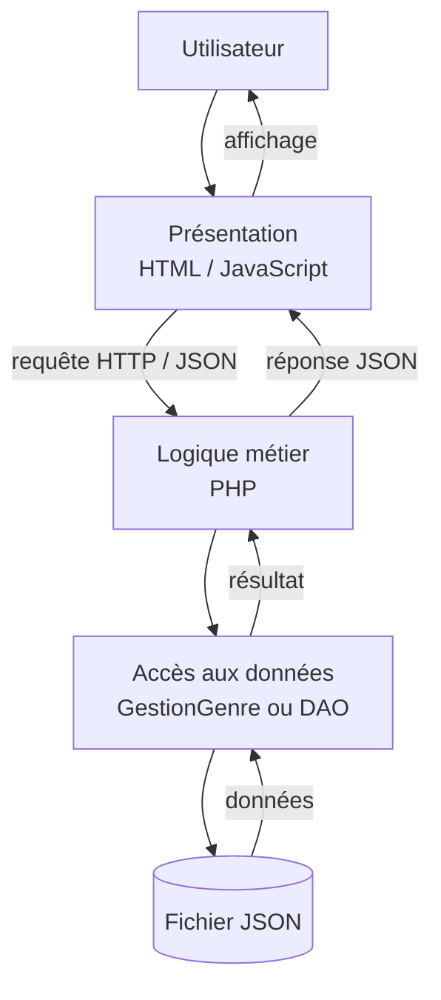
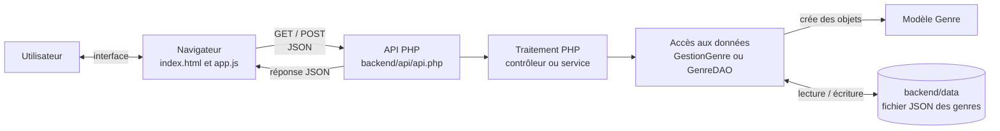

# Rapport

#### Table des matières

- [Rapport](#rapport)
      - [Table des matières](#table-des-matières)
  - [Remerciements](#remerciements)
  - [Introduction](#introduction)
  - [Contexte du projet](#contexte-du-projet)
  - [Objectif de formation (Solicode)](#objectif-de-formation-solicode)
  - [Cahier des charges](#cahier-des-charges)
  - [Méthodologie de travail](#méthodologie-de-travail)
    - [Méthodologie Scrum](#méthodologie-scrum)
      - [Sprint 1](#sprint-1)
      - [Sprint 2](#sprint-2)
    - [Processus 2TUP](#processus-2tup)
    - [Design Thinking](#design-thinking)
  - [Planification](#planification)
  - [Branche fonctionnelle](#branche-fonctionnelle)
    - [Carte d'empathie](#carte-dempathie)
    - [Définition du problème](#définition-du-problème)
    - [Idéation](#idéation)
    - [Diagramme de cas d'utilisation](#diagramme-de-cas-dutilisation)
  - [Branche technique](#branche-technique)
    - [Stack technologique](#stack-technologique)
      - [Technologies Backend](#technologies-backend)
      - [Technologies Frontend](#technologies-frontend)
      - [Base de données](#base-de-données)
      - [Outils et utilitaires externes](#outils-et-utilitaires-externes)
    - [Architecture logicielle](#architecture-logicielle)
      - [Architecture MVC](#architecture-mvc)
      - [Architecture 3-tiers](#architecture-3-tiers)
      - [Architecture globale](#architecture-globale)
    - [Prototype (fonctionnalités, classes)](#prototype-fonctionnalités-classes)
      - [Fonctionnalités clés](#fonctionnalités-clés)
      - [Modèle de données principal](#modèle-de-données-principal)
      - [Structure technique décrite](#structure-technique-décrite)
  - [Conception](#conception)
    - [Diagramme de classes](#diagramme-de-classes)
    - [Maquettes](#maquettes)
  - [Réalisation](#réalisation)
    - [Interfaces](#interfaces)
  - [Conclusion](#conclusion)

## Remerciements

## Introduction

## Contexte du projet

## Objectif de formation (Solicode)

## Cahier des charges

## Méthodologie de travail

### Méthodologie Scrum

La méthodologie Scrum est une méthodologie agile qui permet de gérer un
projet de manière flexible et collaborative, en favorisant la livraison
progressive de fonctionnalités. Elle repose sur l’itération, la priorisation
des tâches et la communication régulière entre les membres de l’équipe.

*Figure 3 : La méthode SCRUM*

**Principes Scrum :**

- **Transparence** : visibilité complète sur les tâches, les objectifs et
  l’avancement du projet pour toute l’équipe.
- **Inspection** : évaluation régulière à la fin de chaque sprint afin
  d’identifier les erreurs, les blocages et les axes d’amélioration.
- **Adaptation** : ajustement du plan de travail en fonction des retours et
  des résultats obtenus lors des sprints.

**Organisation du projet en sprints :**

#### Sprint 1

#### Sprint 2

### Processus 2TUP

La méthode **2TUP** (*Two Tracks Unified Process*) est une méthode de
développement logiciel agile et itérative. Sa particularité repose sur une
architecture en « Y » qui sépare deux axes de réflexion :

- **la branche fonctionnelle**, consacrée à la compréhension des utilisateurs,
  des processus et des besoins métier ;
- **la branche technique**, consacrée à l’étude des contraintes techniques,
  à la conception de l’architecture et au choix des technologies.

Ces deux branches progressent en parallèle, puis se rejoignent dans une phase
de réalisation. Cette organisation permet de limiter les risques, de vérifier
la cohérence entre les besoins métier et la solution technique, et de faire
évoluer progressivement le produit.

**Figure : Processus 2TUP**

La branche fonctionnelle part de la capture des besoins et aboutit à l’analyse
fonctionnelle. En parallèle, la branche technique part des besoins techniques
et aboutit à la définition de l’architecture et des technologies. La
convergence des deux branches déclenche la phase de réalisation, qui comprend
la conception, le codage, les tests, la recette et le déploiement.

La méthode 2TUP fournit un cadre de travail structuré et adaptable. La
séparation entre les branches fonctionnelle et technique facilite la
compréhension des besoins et permet de prendre les décisions techniques au
moment approprié.

### Design Thinking

Le Design Thinking est une approche de résolution de problèmes centrée sur
l’humain. Elle vise à comprendre les besoins réels des utilisateurs afin de
concevoir des solutions innovantes, utiles et adaptées.

*Figure : Méthodologie Design Thinking*

Le Design Thinking est particulièrement utilisé pour :

- encourager la créativité et l’innovation dans la conception de solutions ;
- proposer des réponses adaptées aux besoins des utilisateurs ;
- favoriser la collaboration entre différentes équipes de travail ;
- résoudre des problèmes complexes ou mal définis de manière structurée.

Le processus se compose de plusieurs étapes :

- **Empathie (Empathize)** : comprendre l’utilisateur en l’observant, en
  l’interrogeant et en analysant son comportement afin d’identifier ses
  besoins, ses attentes et ses difficultés.
- **Définition du problème (Define)** : regrouper les informations collectées
  pour formuler un problème clair et centré sur l’utilisateur.
- **Idéation (Ideate)** : générer des idées possibles à l’aide de techniques
  comme le brainstorming ou le mind mapping.
- **Prototype** : créer une version simplifiée de la solution proposée afin de
  tester rapidement les idées.
- **Test** : tester le prototype, recueillir les retours des utilisateurs et
  améliorer la solution en fonction des résultats.

## Planification

## Branche fonctionnelle

### Carte d'empathie

### Définition du problème

### Idéation

### Diagramme de cas d'utilisation

## Branche technique

### Stack technologique

Dans cette section, nous présentons les choix technologiques, les outils et
les architectures adoptés pour assurer le fonctionnement de l’application de
gestion de copropriété immobilière.

#### Technologies Backend

- **PHP 8.2+ et Laravel 12.0** : développement du backend en architecture MVC.
- **Spatie Laravel Permission 7.4** : gestion des rôles et des autorisations.
- **NativePHP** : transformation de l’application Laravel en application
  mobile Android et iOS pour les résidents.

#### Technologies Frontend

- **Blade Templates** : moteur de rendu HTML natif de Laravel.
- **Tailwind CSS** : framework CSS utilitaire pour concevoir l’interface.
- **Alpine** : framework JavaScript léger pour les interactions du frontend.
- **Preline** : bibliothèque de composants UI basés sur Tailwind CSS.
- **Vite** : outil de compilation des ressources CSS et JavaScript.

#### Base de données

- **MySQL** : système de gestion de base de données relationnelle utilisé
  pour stocker les données de l’application.

#### Outils et utilitaires externes

- **Mermaid** : génération de schémas et de diagrammes à partir d’une syntaxe
  textuelle.
- **PlantUML** : conception des diagrammes UML nécessaires à l’analyse et à
  la documentation du système.

### Architecture logicielle

#### Architecture MVC

Le modèle MVC répartit une application en trois rôles :

- **Modèle** : représente les données et les règles qui leur sont liées.
- **Vue** : affiche les informations et reçoit les actions de l’utilisateur.
- **Contrôleur** : reçoit une action, sollicite le modèle et transmet le
  résultat à la vue.

*Figure 1 — Échange MVC : le contrôleur coordonne la vue et le modèle lors
d’une requête.*

Dans le projet décrit par le document source, MVC sert de repère de
compréhension, mais n’est pas appliqué strictement : l’interface HTML et
JavaScript est côté navigateur, tandis que le point d’entrée PHP et les
classes de traitement jouent les rôles de coordination.

#### Architecture 3-tiers

Cette architecture sépare l’application en couches qui communiquent de proche
en proche :

- **Présentation** : interface HTML/JavaScript ; envoie les requêtes et
  affiche les réponses.
- **Logique métier** : traite les opérations demandées par l’utilisateur.
- **Accès aux données** : lit et écrit les données dans leur support de
  stockage.

*Figure 2 — Les trois tiers séparent l’interface, le traitement des
opérations et le stockage.*

#### Architecture globale

Le projet permet de consulter et d’ajouter des genres. L’interface du
navigateur communique avec une API PHP via `fetch`. Les données sont
conservées dans un fichier JSON.

*Figure 3 — Architecture décrite dans le document source.*

Le parcours d’une requête est le suivant :

1. `app.js` envoie une requête **GET** pour afficher les genres ou **POST**
   pour en ajouter un.
2. `api.php` transmet l’opération au traitement PHP, puis à la classe qui lit
   ou met à jour le fichier JSON.
3. Le résultat est renvoyé au navigateur au format JSON ; l’interface affiche
   la liste actualisée.

### Prototype (fonctionnalités, classes)

Le projet technique décrit dans les documents est une application web de
gestion d’une plateforme musicale. Son objectif est de permettre à un
administrateur de gérer les genres musicaux, les artistes et les morceaux.
La version décrite sert de prototype CRUD.

#### Fonctionnalités clés

- **Gestion des genres** : ajouter, afficher, modifier et supprimer des
  genres musicaux.
- **Gestion des artistes** : ajouter des artistes avec leur nom et leur
  image de profil.
- **Gestion des morceaux** : enregistrer un titre, une couverture, un
  fichier audio, son statut et sa date de publication.
- **Association des données** : chaque morceau est lié à un artiste et à un
  genre.
- **Organisation du catalogue** : centraliser les musiques par genre et par
  artiste.

#### Modèle de données principal

- **Artistes** : `id`, `ArtistName`, `dateOfCreation`, `ProfilePicture`.
- **Genres** : `id`, `genreName`.
- **Morceaux** : `id`, `SongTitle`, `dateOfCreation`, `ProfilePicture`,
  `songFilePath`, `status`, `dateOfPublication`, `artist_id`, `genre_id`.

Un artiste peut avoir plusieurs morceaux et un genre peut contenir plusieurs
morceaux. Chaque morceau appartient à un seul artiste et à un seul genre.

#### Structure technique décrite

- **Frontend** : HTML, CSS/Tailwind CSS et JavaScript.
- **Backend** : PHP, contrôleurs, services, DAO ou accès aux données, et API
  REST simple.
- **Base de données** : schéma SQL de référence pour MySQL/MariaDB ;
  implémentation prototype possible via un fichier JSON.

## Conception

### Diagramme de classes

### Maquettes

## Réalisation

### Interfaces

## Conclusion

Ce prototype a permis de valider l’organisation entre la base de données, le
backend et le frontend pour une application de gestion musicale. Il sert de
base à une version plus avancée avec authentification, gestion complète des
artistes, téléversement de fichiers audio et interface d’administration plus
complète.
