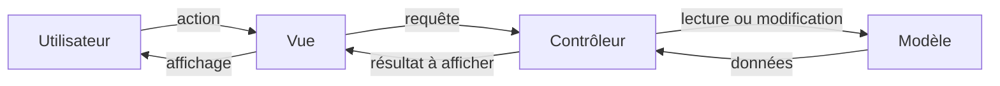
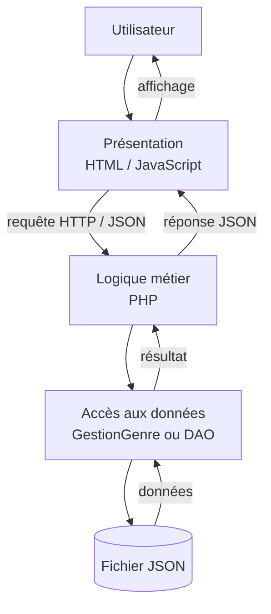
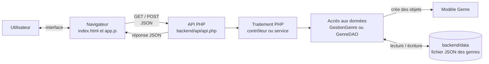

# Rapport

#### Table des matières

- [Rapport](#rapport)
      - [Table des matières](#table-des-matières)
  - [Remerciements](#remerciements)
  - [Introduction](#introduction)
  - [Contexte du projet](#contexte-du-projet)
  - [Cahier des charges](#cahier-des-charges)
  - [Méthodologie de travail](#méthodologie-de-travail)
    - [Méthodologie Scrum](#méthodologie-scrum)
      - [Méthode de travail](#méthode-de-travail)
        - [La méthode SCRUM](#la-méthode-scrum)
          - [Sprint 1](#sprint-1)
          - [Sprint 2 :](#sprint-2-)
    - [Processus 2TUP](#processus-2tup)
        - [2.3 2TUP](#23-2tup)
          - [Définition](#définition)
          - [Schéma](#schéma)
          - [Conclusion](#conclusion)
    - [Design Thinking](#design-thinking)
        - [Design thinking](#design-thinking-1)
        - [Les étapes du Design Thinking](#les-étapes-du-design-thinking)
  - [Planification](#planification)
  - [Branche fonctionnelle](#branche-fonctionnelle)
    - [Carte d'empathie](#carte-dempathie)
    - [Définition du problème](#définition-du-problème)
    - [Idéation](#idéation)
    - [Diagramme de cas d'utilisation](#diagramme-de-cas-dutilisation)
  - [Branche technique](#branche-technique)
      - [Choix technologiques](#choix-technologiques)
    - [Technologies Backend](#technologies-backend)
    - [Technologies Frontend](#technologies-frontend)
    - [Base de données](#base-de-données)
    - [Outils et utilitaires externes](#outils-et-utilitaires-externes)
    - [Stack technologique](#stack-technologique)
        - [Choix technologiques](#choix-technologiques-1)
          - [Technologies Backend](#technologies-backend-1)
          - [Technologies Frontend](#technologies-frontend-1)
          - [Base de données](#base-de-données-1)
          - [Outils et utilitaires externes](#outils-et-utilitaires-externes-1)
    - [Architecture logicielle](#architecture-logicielle)
      - [Architecture du système](#architecture-du-système)
        - [Architecture MVC](#architecture-mvc)
        - [Architecture 3-tiers](#architecture-3-tiers)
        - [Architecture globale](#architecture-globale)
    - [Prototype (fonctionnalités, classes)](#prototype-fonctionnalités-classes)
      - [Fonctionnalités clés](#fonctionnalités-clés)
      - [Modèle de données principal](#modèle-de-données-principal)
      - [Structure technique décrite](#structure-technique-décrite)
  - [Conception](#conception)
    - [Diagramme de classes](#diagramme-de-classes)
    - [Maquettes](#maquettes)
  - [Réalisation](#réalisation)
    - [Interfaces](#interfaces)
  - [Conclusion](#conclusion-1)

## Remerciements

## Introduction

## Contexte du projet

## Cahier des charges

## Méthodologie de travail

### Méthodologie Scrum

#### Méthode de travail

##### La méthode SCRUM

La méthodologie Scrum est une méthodologie agile qui permet de gérer un projet de manière flexible et collaborative, en favorisant la livraison progressive de fonctionnalités. Elle repose sur l'itération, la priorisation des tâches et la communication régulière entre les membres de l'équipe. Dans le cadre de ce projet Promatch, nous avons organisé le travail selon les principes de Scrum, ce qui nous a permis de mieux planifier, suivre et livrer les différentes fonctionnalités de manière efficace.

*Figure 3 : La méthode SCRUM*

**Principe Scrum :**

- **Transparence** : visibilité complète sur les tâches, les objectifs et l'avancement du projet pour toute l'équipe.
- **Inspection** : évaluation régulière à la fin de chaque sprint afin d'identifier les erreurs, les blocages et les axes d'amélioration.
- **Adaptation** : ajustement du plan de travail en fonction des retours et des résultats obtenus lors des sprints.

**Organisation du projet en sprints :**

###### Sprint 1

-

###### Sprint 2 :

-

### Processus 2TUP

##### 2.3 2TUP

###### Définition

La méthode **2TUP** (*Two Tracks Unified Process*) est une méthode de
développement logiciel agile et itérative. Elle peut être adaptée au contexte
de **[Nom du projet]**, à ses objectifs et aux besoins de **[utilisateurs ou
organisation]**.

Sa particularité repose sur une architecture en « Y » qui sépare
distinctement deux axes de réflexion :

- **la branche fonctionnelle**, consacrée à la compréhension des utilisateurs,
  des processus et des besoins métier ;
- **la branche technique**, consacrée à l'étude des contraintes techniques,
  à la conception de l'architecture et au choix des technologies.

La branche fonctionnelle permet de définir **[fonctionnalités ou besoins
principaux]**, tandis que la branche technique permet de déterminer
l'architecture et les outils nécessaires, tels que **[langages, frameworks,
base de données ou services]**.

Ces deux branches progressent en parallèle, puis se rejoignent dans une phase
de réalisation. Cette organisation permet de limiter les risques, de vérifier
la cohérence entre les besoins métier et la solution technique, et de faire
évoluer progressivement le produit.

###### Schéma

Le schéma suivant présente le fonctionnement général de la méthode 2TUP.
Les éléments entre crochets peuvent être remplacés par les informations
propres à chaque projet.

**Figure [numéro] : Processus 2TUP appliqué à [Nom du projet]**

La branche fonctionnelle part de la capture des besoins et aboutit à
l'analyse fonctionnelle. En parallèle, la branche technique part des besoins
techniques et aboutit à la définition de l'architecture et des technologies.
La convergence des deux branches déclenche la phase de réalisation, qui
comprend la conception, le codage, les tests, la recette et le déploiement.

###### Conclusion

La méthode 2TUP fournit un cadre de travail structuré et adaptable pour la
réalisation de **[Nom du projet]**. La séparation entre les branches
fonctionnelle et technique facilite la compréhension des besoins et permet de
prendre les décisions techniques au moment approprié.

En réunissant ces deux branches dans une phase de réalisation progressive,
la méthode favorise la maîtrise des risques, l'amélioration continue et
l'alignement du produit final sur les besoins de **[utilisateurs ou
organisation]**. Elle constitue ainsi une approche pertinente pour les
projets dont les exigences fonctionnelles et les contraintes techniques
doivent être analysées conjointement.

### Design Thinking

Ainsi, l’adoption de la méthode Scrum a permis d’assurer une organisation efficace du travail et une meilleure gestion du projet. Elle a contribué à améliorer la qualité des fonctionnalités développées et à garantir un déroulement structuré du projet ImmoSync.

##### Design thinking

Le Design Thinking est une approche de résolution de problèmes centrée sur l’humain. Elle vise à comprendre en profondeur les besoins réels des utilisateurs afin de concevoir des solutions innovantes, utiles et adaptées. Cette méthode est largement utilisée dans les domaines du design, de la technologie, de l’éducation et de l’innovation pour répondre à des problématiques complexes.

  

*Figure : Méthodologie Design Thinking*

Le Design Thinking est particulièrement utilisé pour :

- Encourager la créativité et l’innovation dans la conception de solutions ;
- Proposer des réponses réellement adaptées aux besoins des utilisateurs ;
- Favoriser la collaboration entre différentes équipes de travail ;
- Résoudre des problèmes complexes ou mal définis de manière structurée.

##### Les étapes du Design Thinking

Le processus du Design Thinking se compose de plusieurs étapes essentielles :

- **Empathie (Empathize)** : cette étape consiste à comprendre l’utilisateur en l’observant, en l’interrogeant et en analysant son comportement. L’objectif est d’identifier ses besoins, ses attentes et ses difficultés réelles.
- **Définition du problème (Define)** : elle permet de regrouper les informations collectées afin de formuler un problème clair et centré sur l’utilisateur, souvent exprimé sous forme de question comme : « Comment pourrions-nous améliorer… ? »
- **Idéation (Ideate)** : cette phase consiste à générer un maximum d’idées possibles sans jugement, en utilisant des techniques comme le brainstorming ou le mind mapping afin de stimuler la créativité.
- **Prototype** : elle consiste à créer une version simplifiée de la solution proposée (maquette, interface ou modèle) afin de tester rapidement les idées.
- **Test** : cette dernière étape permet de tester le prototype auprès des utilisateurs, de recueillir leurs retours et d’améliorer la solution en fonction des résultats obtenus.

Le Design Thinking est donc une méthode structurée et flexible qui permet de transformer une idée en solution concrète en mettant toujours l’utilisateur au centre du processus.

## Planification

## Branche fonctionnelle

### Carte d'empathie

### Définition du problème

### Idéation

### Diagramme de cas d'utilisation

## Branche technique

Dans cette section, nous présentons la branche technique de notre projet, qui consiste à décrire les choix technologiques, les outils et les architectures adoptés pour assurer le bon fonctionnement de l'application, tout en garantissant une solution performante, sécurisée et adaptée aux besoins identifiés.

---

#### Choix technologiques

Dans le cadre de ce projet, plusieurs technologies modernes et complémentaires ont été sélectionnées pour garantir la performance, la maintenabilité, la sécurité et la rapidité de la plateforme de gestion de copropriété immobilière.

### Technologies Backend

- **PHP 8.2+ et Laravel 12.0** : Ce duo technologique est utilisé pour développer le backend en architecture MVC, garantissant une base sécurisée, des performances accrues et un code structuré.
- **Spatie Laravel Permission 7.4** : Bibliothèque pour la gestion professionnelle des rôles et des autorisations, garantissant un cloisonnement strict des accès.
- **NativePHP** : Framework pour transformer l'application Laravel en application mobile (Android, iOS) pour les résidents.

### Technologies Frontend

- **Blade Templates** : Moteur de rendu HTML, natif de Laravel, utilisé pour structurer l'interface utilisateur en composants réutilisables.
- **Tailwind CSS** : Framework CSS utilitaire ultra-rapide, permettant de concevoir une interface sur mesure, moderne, responsive et compatible mode sombre.
- **Alpine** : Framework JavaScript léger et réactif, utilisé pour les animations du frontend (barres de recherche, modales, menus déroulants).
- **Preline** : Bibliothèque de composants UI basés sur Tailwind CSS, accélérant le développement avec des modèles prêts à l'emploi.
- **Vite** : Outil de build moderne, optimisant la compilation des ressources CSS/JS pour un chargement de page ultra-rapide en production.

### Base de données

- **MySQL** : Système de gestion de base de données relationnelle (SGBDR) fiable, utilisé pour stocker l'intégralité des données de l'application.

### Outils et utilitaires externes

- **Mermaid** : Outil permettant de générer des schémas et diagrammes à partir d'une syntaxe textuelle simple.
- **PlantUML** : Solution utilisée pour concevoir les différents diagrammes UML nécessaires à l'analyse et à la documentation du système.

### Stack technologique

Dans cette section, nous présentons la branche technique de notre projet, qui consiste à décrire les choix technologiques, les outils et les architectures adoptés pour assurer le bon fonctionnement de l'application, tout en garantissant une solution performante, sécurisée et adaptée aux besoins identifiés.

---

##### Choix technologiques

Dans le cadre de ce projet, plusieurs technologies modernes et complémentaires ont été sélectionnées pour garantir la performance, la maintenabilité, la sécurité et la rapidité de la plateforme de gestion de copropriété immobilière.

###### Technologies Backend

- **PHP 8.2+ et Laravel 12.0** : Ce duo technologique est utilisé pour développer le backend en architecture MVC, garantissant une base sécurisée, des performances accrues et un code structuré.
- **Spatie Laravel Permission 7.4** : Bibliothèque pour la gestion professionnelle des rôles et des autorisations, garantissant un cloisonnement strict des accès.
- **NativePHP** : Framework pour transformer l'application Laravel en application mobile (Android, iOS) pour les résidents.

###### Technologies Frontend

- **Blade Templates** : Moteur de rendu HTML, natif de Laravel, utilisé pour structurer l'interface utilisateur en composants réutilisables.
- **Tailwind CSS** : Framework CSS utilitaire ultra-rapide, permettant de concevoir une interface sur mesure, moderne, responsive et compatible mode sombre.
- **Alpine** : Framework JavaScript léger et réactif, utilisé pour les animations du frontend (barres de recherche, modales, menus déroulants).
- **Preline** : Bibliothèque de composants UI basés sur Tailwind CSS, accélérant le développement avec des modèles prêts à l'emploi.
- **Vite** : Outil de build moderne, optimisant la compilation des ressources CSS/JS pour un chargement de page ultra-rapide en production.

###### Base de données

- **MySQL** : Système de gestion de base de données relationnelle (SGBDR) fiable, utilisé pour stocker l'intégralité des données de l'application.

###### Outils et utilitaires externes

- **Mermaid** : Outil permettant de générer des schémas et diagrammes à partir d'une syntaxe textuelle simple.
- **PlantUML** : Solution utilisée pour concevoir les différents diagrammes UML nécessaires à l'analyse et à la documentation du système.

### Architecture logicielle

#### Architecture du système

##### Architecture MVC

Le modèle MVC répartit une application en trois rôles :

- **Modèle** : représente les données et les règles qui leur sont liées.
- **Vue** : affiche les informations et reçoit les actions de l’utilisateur.
- **Contrôleur** : reçoit une action, sollicite le modèle et transmet le résultat à la vue.

_Figure 1 — Échange MVC : le contrôleur coordonne la vue et le modèle lors d’une requête._

Dans le projet, MVC sert de **repère de compréhension**, mais n’est pas appliqué strictement : l’interface HTML/JavaScript est côté navigateur, tandis que le point d’entrée PHP et les classes de traitement jouent les rôles de coordination. La classe `Genre` représente les données métier.

##### Architecture 3-tiers

Cette architecture sépare l’application en couches qui communiquent de proche en proche :

- **Présentation** : interface HTML/JavaScript ; envoie les requêtes et affiche les réponses.
- **Logique métier** : traite les opérations demandées par l’utilisateur.
- **Accès aux données** : lit et écrit les données dans leur support de stockage.

_Figure 2 — Les trois tiers séparent l’interface, le traitement des opérations et le stockage._

##### Architecture globale

Le projet permet de consulter et d’ajouter des genres. L’interface du navigateur communique avec une API PHP via `fetch`. Les données sont conservées dans un fichier JSON ; elles ne sont pas stockées dans une base de données relationnelle.

_Figure 3 — Architecture commune aux versions du projet ; les noms des classes varient selon la version._

Le parcours d’une requête est le suivant :

1. `app.js` envoie une requête **GET** pour afficher les genres ou **POST** pour en ajouter un.
2. `api.php` transmet l’opération au traitement PHP, puis à la classe qui lit ou met à jour le fichier JSON.
3. Le résultat est renvoyé au navigateur au format JSON ; l’interface affiche la liste actualisée.

### Prototype (fonctionnalités, classes)

Le projet technique décrit dans les documents est une application web de
gestion d’une plateforme musicale. Son objectif est de permettre à un
administrateur de gérer les genres musicaux, les artistes et les morceaux.
La version décrite sert de prototype CRUD.

#### Fonctionnalités clés

- **Gestion des genres** : ajouter, afficher, modifier et supprimer des
  genres musicaux.
- **Gestion des artistes** : ajouter des artistes avec leur nom et leur
  image de profil.
- **Gestion des morceaux** : enregistrer un titre, une couverture, un
  fichier audio, son statut et sa date de publication.
- **Association des données** : chaque morceau est lié à un artiste et à un
  genre.
- **Organisation du catalogue** : centraliser les musiques par genre et par
  artiste.

#### Modèle de données principal

- **Artistes** : `id`, `ArtistName`, `dateOfCreation`, `ProfilePicture`.
- **Genres** : `id`, `genreName`.
- **Morceaux** : `id`, `SongTitle`, `dateOfCreation`, `ProfilePicture`,
  `songFilePath`, `status`, `dateOfPublication`, `artist_id`, `genre_id`.

Un artiste peut avoir plusieurs morceaux et un genre peut contenir plusieurs
morceaux. Chaque morceau appartient à un seul artiste et à un seul genre.

#### Structure technique décrite

- **Frontend** : HTML, CSS/Tailwind CSS et JavaScript.
- **Backend** : PHP, contrôleurs, services, DAO ou accès aux données, et API
  REST simple.
- **Base de données** : schéma SQL de référence pour MySQL/MariaDB ;
  implémentation prototype possible via un fichier JSON.

## Conception

### Diagramme de classes

### Maquettes

## Réalisation

### Interfaces

## Conclusion

Ce prototype a permis de valider l’organisation entre la base de données, le
backend et le frontend pour une application de gestion musicale. Il sert de
base à une version plus avancée avec authentification, gestion complète des
artistes, téléversement de fichiers audio et interface d’administration plus
complète.
